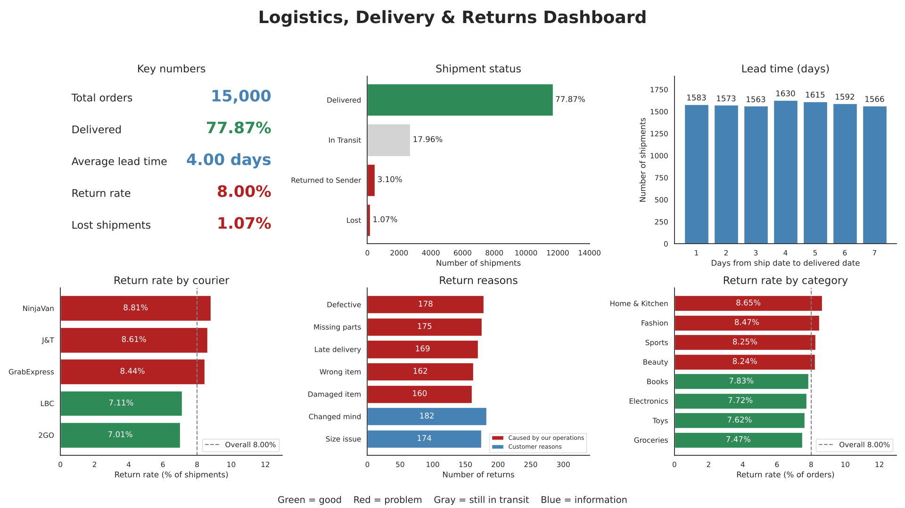
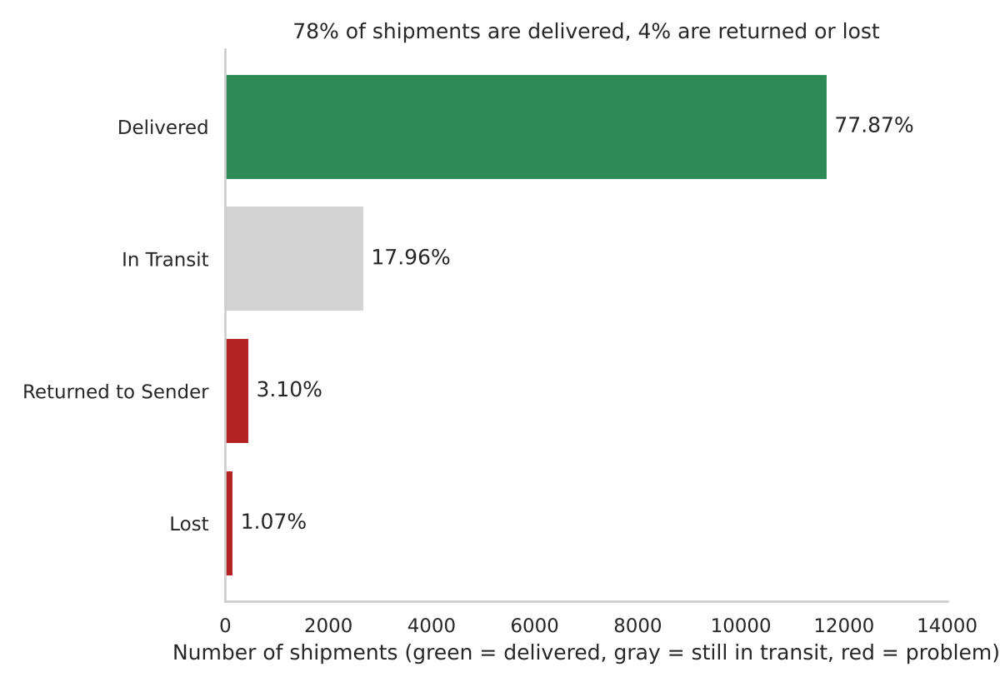
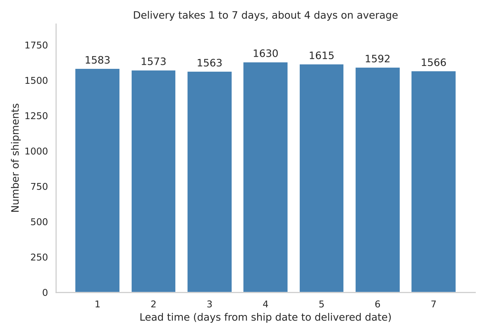
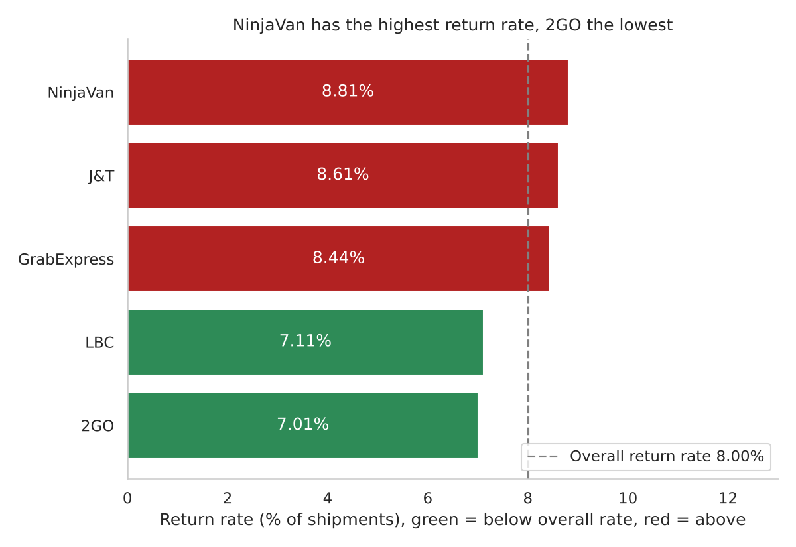
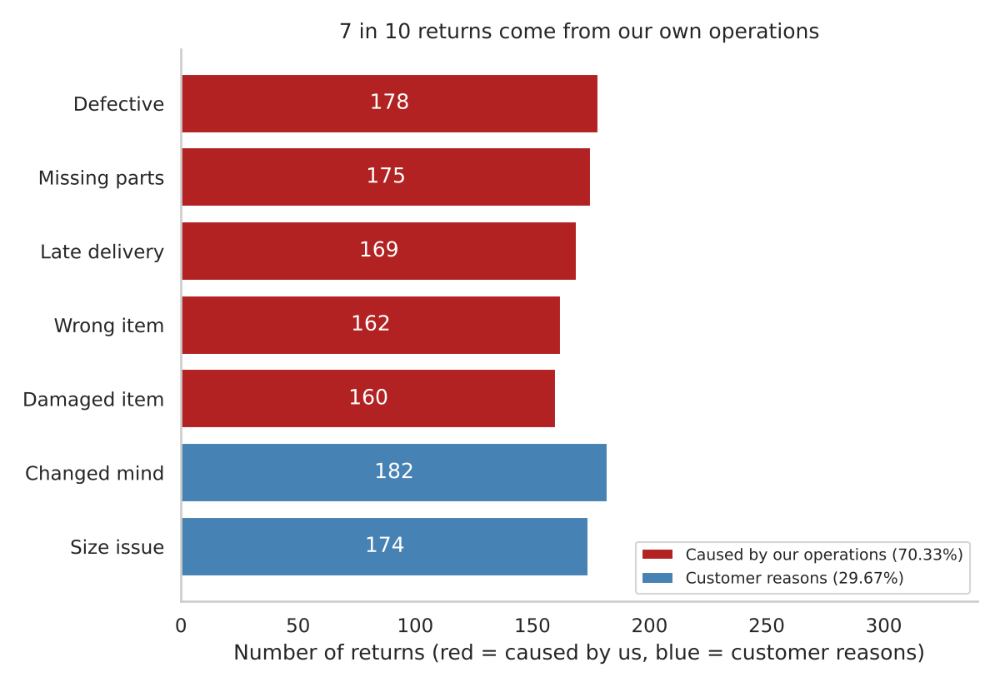
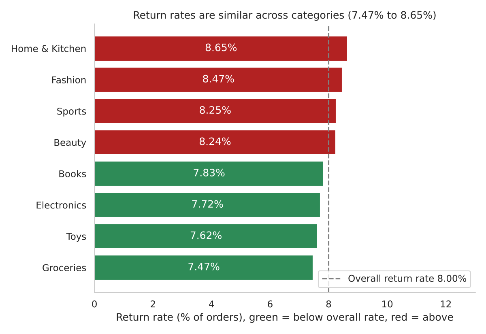
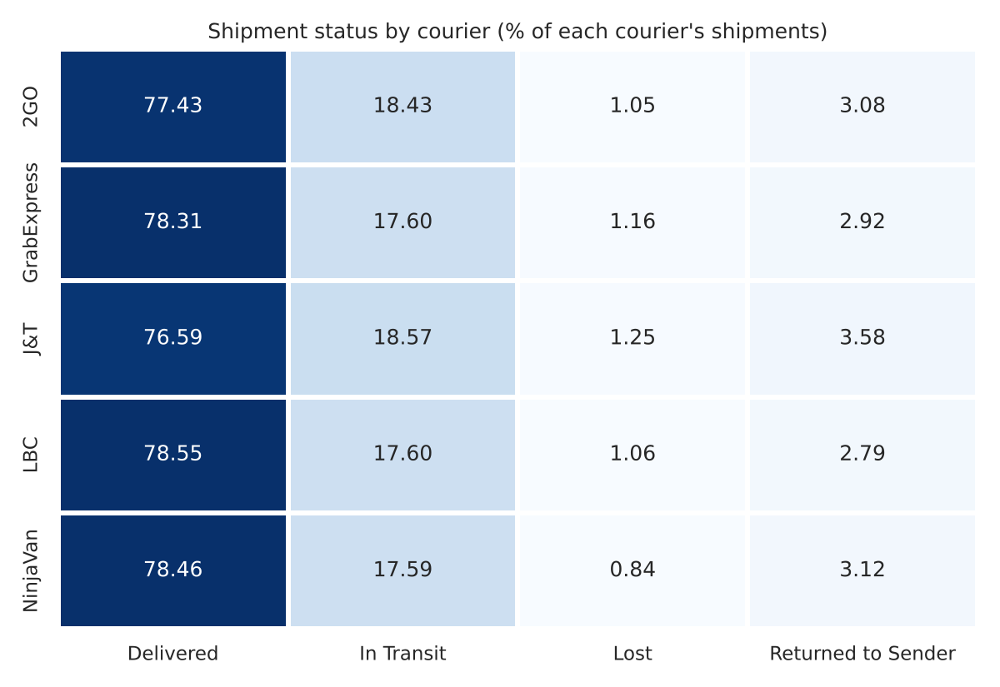

# Logistics, Delivery & Returns Insights

**Python Programming Capstone, Option B | DataSense Analytics DASP, Batch B02**

**Author:** Cristine Angelica Marie Serrano Tolentino

**Business question:** How well are we delivering, and what causes returns?

I cleaned 7 messy CSV tables from an online retailer (15,000 orders, January 2024 to January 2026) and built the analysis in Python (pandas, numpy, matplotlib and seaborn) in a Jupyter notebook.

## Executive Summary

This project looks at how well we deliver orders and what causes returns, using 15,000 orders from 7 tables.
I cleaned the data first (documented in a 35-line cleaning log, original files untouched), then built the analysis in Python.
77.87% of shipments were delivered, 17.96% are still in transit, and 4.17% were returned to sender or lost.
Delivered shipments take 1 to 7 days, about 4.00 days on average, and all five couriers are within 0.06 days of each other.
1,200 of 15,000 orders were returned, an overall return rate of 8.00%.
NinjaVan (8.81%), J&T (8.61%) and GrabExpress (8.44%) are above the overall rate, while 2GO (7.01%) and LBC (7.11%) are below it.
J&T also has the lowest delivered rate (76.59%) and the highest returned to sender rate (3.58%).
70.33% of returns (844) come from reasons we control: defective, missing parts, late delivery, wrong item and damaged item.
Return rates are similar across categories (7.47% to 8.65%), so category is not the main driver.
Top recommendation 1: add a quality and packing check before dispatch to reduce the returns we cause.
Top recommendation 2: track return rate and lost shipments for each courier every month, and review NinjaVan, J&T and GrabExpress.
Three more recommendations: reduce lost deliveries (starting with J&T), set a delivery time target, and improve date and refund data.
Data note: the data is synthetic and some dates are out of order (for example, shipped before ordered), so lead time results need care.

## Key numbers

| Measure | Result |
|---|---|
| Orders analyzed | 15,000 |
| Shipments delivered | 77.87% |
| Shipments returned to sender or lost | 4.17% |
| Average delivery time (delivered shipments) | 4.00 days (range 1 to 7) |
| Orders returned | 8.00% (1,200 orders) |
| Returns caused by our own operations | 70.33% (844 returns) |
| Highest return rate by courier | NinjaVan, 8.81% |
| Lowest return rate by courier | 2GO, 7.01% |

## Recommendations

1. Reduce the returns we cause with a quality and packing check before dispatch.
2. Review the couriers with above-average return rates (NinjaVan, J&T, GrabExpress) with a monthly scorecard.
3. Reduce lost and failed deliveries, starting with J&T.
4. Set a delivery time target.
5. Improve date and refund data so the next analysis is more reliable.

The full reasoning is in the report and the one-page summary.

## Files in this repository

| File or folder | What it is |
|---|---|
| `Capstone_OptionB_Logistics_Returns.ipynb` | The full Jupyter notebook: loading, cleaning, 35-line cleaning log, KPIs, charts, dashboard, insights |
| `executive_summary.txt` | Executive Summary (13 lines) |
| `One_Page_Insights_Summary.pdf` | One-page insights summary |
| `DASP - B02 - Cristine Angelica Marie Serrano Tolentino.pdf` | Full capstone report (8 sections) |
| `cleaned_customers.csv` | Cleaned customers table (5,000 rows) |
| `cleaned_products.csv` | Cleaned products table (800 rows) |
| `cleaned_orders.csv`, `cleaned_order_items.csv`, `cleaned_payments.csv`, `cleaned_shipments.csv`, `cleaned_returns.csv`, `cleaning_log.csv` | The other cleaned tables and the cleaning log |
| `chart1_shipment_status.png` to `chart6_status_by_courier_heatmap.png` | 6 exported charts (PNG) |
| `dashboard_1920x1080.png` | The dashboard at 1920 x 1080 |

## Charts

| | |
|---|---|
|  |  |
|  |  |
|  |  |

Color rules in every chart: green = good, red = problem, gray = in progress, blue = information.

## How I cleaned the data

- The original columns are never changed. Every fix goes into a new `_clean` column.
- Every fix is recorded in a 35-line cleaning log (`cleaning_log.csv` and Section 3.11 of the notebook).
- Main steps: removed duplicate rows (50 customers, 75 orders, 262 order lines), standardized dates, categories, prices, gender and phone/email formats, removed 372 order lines with quantity 0, filled 2,217 blank prices from the product catalog, and flagged orphan records instead of deleting them.

## How to run the notebook

1. Install Python with `pandas`, `numpy`, `matplotlib`, `seaborn` and `jupyter`.
2. Put the 7 original CSV files (customers, products, orders, order_items, payments, shipments, returns) in a folder called `data_raw` next to the notebook.
3. Open the notebook and choose Kernel, then Restart & Run All. It creates the `data_clean` and `charts` folders.

The original data files are not included in this repository.

## Data limits

The data is synthetic (practice data). Some dates are out of order (for example, 7,397 shipments are dated before the order date), 558 delivered shipments have no delivered date, and 347 returns have a refund flag that does not match the refund amount. Lead time uses ship date to delivered date for 11,122 delivered shipments, and results should be read with care.
